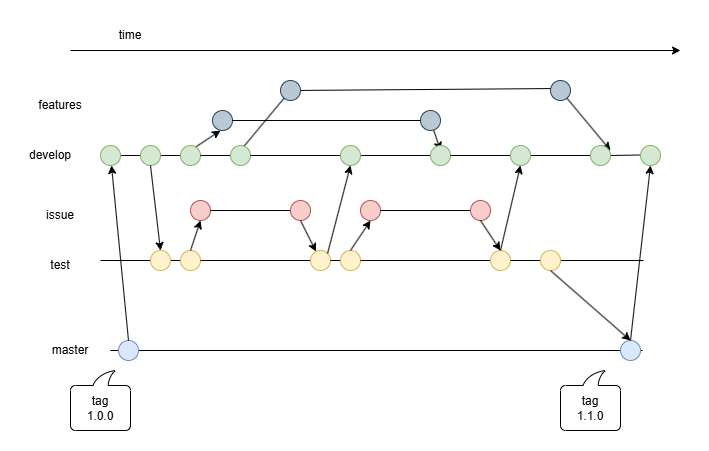

# Branching Model

This document explains the branching strategy used for this project, based on the diagram:

## Main Branches

There are three primary branches in the repository:

- **develop**  
  The main development branch. All new feature branches are created from here. Continuous development happens in `develop`.

- **test**  
  The branch used for pre-production testing. Developers promote stable changes from `develop` into `test` once a feature set is ready for testing.

- **main**  
  The production branch. Only thoroughly tested and approved code from `test` is merged into `main`. Every commit to `main` should correspond to a tagged release.

## Supporting Branches

In addition to the main branches, supporting branches are used to manage specific development tasks:

- **feature/\***  
  Feature branches are created from `develop`. They contain new features or enhancements. When a feature is complete and stable, it is merged back into `develop`.

- **fix/\***  
  Fix branches are created from `test` when a bug is found during testing. After fixing the bug, the fix is merged both into `test` and into `develop` to ensure consistency.

- **hotfix/\*** *(optional, not shown in the diagram)*  
  Hotfixes could be created directly from `main` for urgent production issues, and then merged back into both `main` and `develop`.

## Workflow Overview

1. Developers pull the latest `develop` branch and create a new `feature/*` branch.
2. Developers work in their feature branch, regularly updating it with the latest changes from `develop`.
3. Once development is complete, the feature branch is merged back into `develop`.
4. When a release candidate is ready, `develop` is manually merged into `test`.
5. Testers validate the changes in `test`. If bugs are found:
    - Developers branch off `test` to create a `fix/*` branch.
    - Fixes are merged into both `test` and `develop`.
6. After successful testing, `test` is manually merged into `main`.
7. A Git tag is created on `main` to mark the release version (e.g., `v1.0.0`).
8. CI/CD pipelines deploy from `main` automatically.

## Branch Summary Table

| Branch Type | Purpose                                |
|:------------|:---------------------------------------|
| `develop`   | Ongoing development integration        |
| `feature/*` | New features developed off `develop`   |
| `test`      | Pre-production integration and testing |
| `fix/*`     | Bug fixes branched from `test`         |
| `main`      | Stable, production-ready code          |

---

