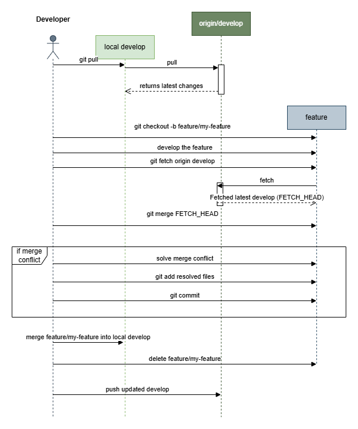

# Feature Development

This document describes how to develop new features following our Git branching strategy, based on the diagram:



## Creating a Feature Branch

- Always create your feature branch from the latest `develop` branch.
- If the project uses GitHub Issues or a GitHub Project board, prefer creating the branch from the issue or task in GitHub.
  - This improves traceability because the branch and later pull request are linked to the work item automatically.
  - Keep or adjust the suggested branch name so it still follows the agreed prefix and naming convention for the repository.
- Before branching, make sure your local `develop` branch is up-to-date:

```bash
git checkout develop
git pull origin develop
```

- Then create a new feature branch:

```bash
git checkout -b feature/<jira-task-id>-<short-description>
```

**Example:**
```bash
git checkout -b feature/CC-1234-add-user-authentication
```

✅ Prefixing with the Jira Task ID improves traceability between commits, branches, and project management tools.

If the branch was created from a GitHub issue or task instead of the command line, the same rule still applies: keep the work-item ID in the branch name and make sure the prefix is correct for the project.

---

## Developing the Feature

- Work normally in your feature branch.
- Keep commits small and meaningful.
- Regularly synchronize your feature branch with `develop` to avoid large merge conflicts:

```bash
git fetch origin develop
git merge FETCH_HEAD
```

- If conflicts occur during merge, solve them immediately and commit the conflict resolution.

---

## Merging Feature Branches

Before merging a feature branch into `develop`:

1. **Update your feature branch** with the latest `develop` changes (fetch and merge).
2. **Solve any conflicts** locally first.
3. **Test** locally to ensure stability after merge.
4. Merge the feature branch into `develop`:
   ```bash
    git checkout develop
    git merge feature/<jira-task-id>-<short-description>
    git push origin develop
    ```
5. After merging successfully, **delete the feature branch** to keep the repository clean:
    ```bash
    git branch -d feature/<jira-task-id>-<short-description>
    git push origin --delete feature/<jira-task-id>-<short-description>
    ```

✅ This keeps Git history clean and avoids stale branches.

---

## Branch Naming Guidelines

- Prefix: `feature/`
- Lowercase names
- Use hyphens (`-`) to separate words
- Include the Jira Task ID at the start
- Keep descriptions short but meaningful

**Examples:**
- `feature/CC-1234-add-login-page`
- `feature/CC-5678-improve-email-sending`

✅ Consistent branch naming improves automation, traceability, and teamwork.

---
