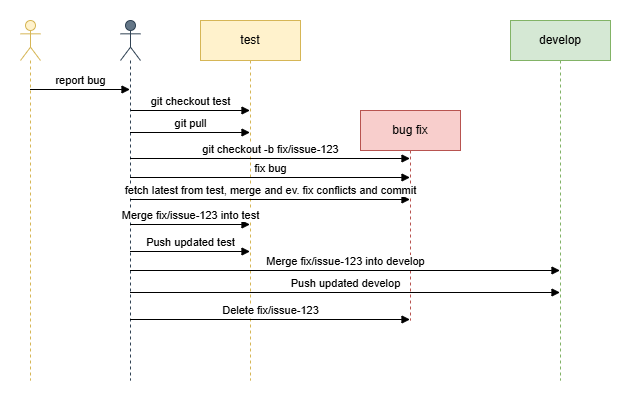

# Bugfix Handling

This document explains how to handle bugfixes found during testing, based on the diagram:



## Handling a Bug Found in Test

When a tester identifies a bug in the `test` environment, the fix follows a controlled process to ensure stability.

### Steps for Bugfixing

1. **Start from the `test` branch:**

   Make sure you have the latest version of `test` locally:

   ```bash
   git checkout test
   git pull origin test
   ```

2. **Create a bugfix branch:**

   ```bash
   git checkout -b fix/<jira-task-id>-<short-description>
   ```

   **Example:**
   ```bash
   git checkout -b fix/CC-5678-fix-email-template
   ```

   ✅ Branching directly from `test` ensures you fix the right version of the code without introducing unrelated new changes from `develop`.

   ---

   ### Developing and Merging the Fix

3. **Fix the bug** locally in your `fix/*` branch.

4. **Synchronize with latest `test`:**

   Before merging back, ensure your fix branch is updated:

   ```bash
   git fetch origin test
   git merge FETCH_HEAD
   ```

   ✅ Solving conflicts early prevents broken merges into `test`.

5. **Merge back into `test`:**

   ```bash
   git checkout test
   git merge fix/<jira-task-id>-<short-description>
   git push origin test
   ```

6. **Also merge the fix into `develop`:**

   ```bash
   git checkout develop
   git pull origin develop
   git merge fix/<jira-task-id>-<short-description>
   git push origin develop
   ```

   ✅ This ensures that future development work in `develop` includes the bugfix.

7. **Delete the fix branch (optional cleanup):**

   ```bash
   git branch -d fix/<jira-task-id>-<short-description>
       git push origin --delete fix/<jira-task-id>-<short-description>
   ```

---

## Branch Naming Guidelines for Bugfixes

- Prefix: `fix/`
- Include the Jira Task ID
- Lowercase names
- Use hyphens (`-`) for separating words
- Keep the description short but meaningful

**Examples:**
- `fix/CC-5678-fix-email-template`
- `fix/CC-8910-correct-login-redirect`

---

## Important Notes

- Always merge fixes into **both `test` and `develop`** to keep branches aligned.
- Resolve any conflicts **in your fix branch first** before merging into `test` or `develop`.
- Push early and often to avoid losing work during bug fixing.

---
